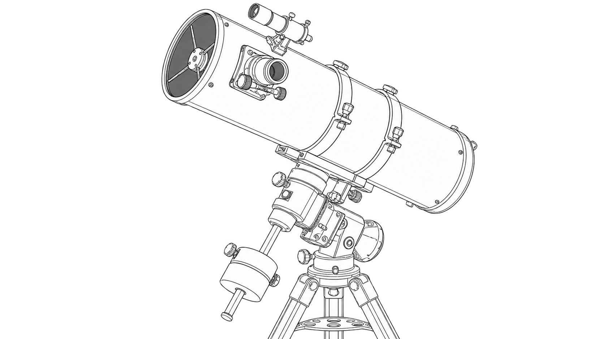
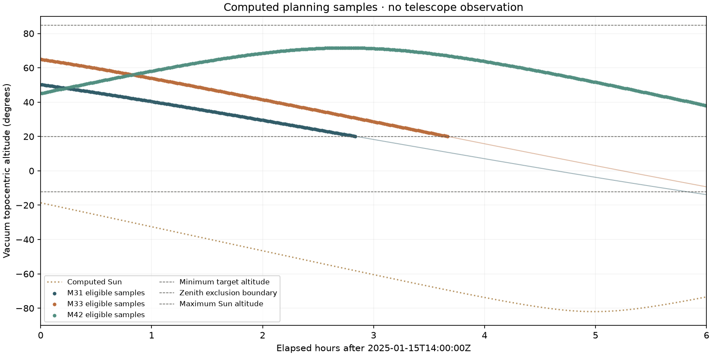
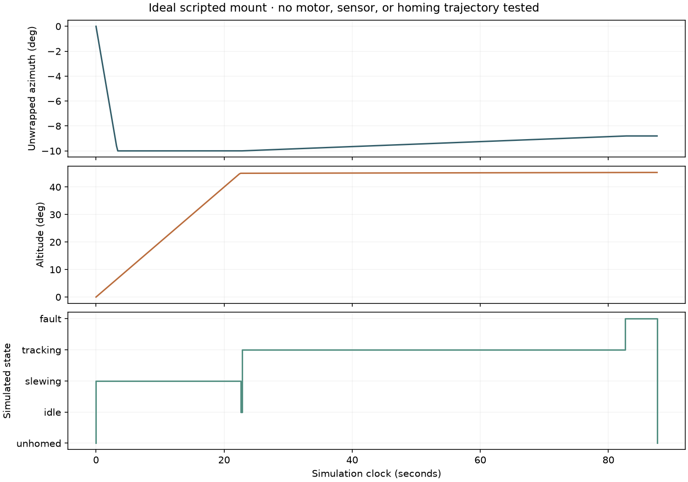

# Robotic Telescope



*Generated line-art concept illustration.*

An offline observing planner and an ideal two-axis mount simulator. Compute target altitude/azimuth from explicit UTC, WGS84 location, and fixed ICRS coordinates. Inspect sampled visibility, actual sky-track plots, cable-wrap choices, rate-limited motion, and latched simulated faults.

**No physical telescope, motor control, observation, or pointing accuracy has been verified.** The astronomical calculations and the scripted mount simulation are separate demonstrations. The software has no instrument or network writer.

## Run the demo

Use Python 3.12 or 3.13. The astronomy data are pinned and bundled by the declared dependencies; the application does not download data or resolve target names online.

```sh
python -m venv .venv
# macOS / Linux
source .venv/bin/activate
# Windows PowerShell: .venv\Scripts\Activate.ps1
python -m pip install -r requirements-benchmark.txt
python -m pip install --no-deps -e .
telescope-lab demo --output artifacts/study
```

Open `artifacts/study/index.html` directly in a browser. The report uses local relative images and no scripts, account, or external map. A recorded run is in [demo/index.html](demo/index.html). Existing output directories are rejected.

## Actual computed example



The fixed example covers **15 January 2025, 14:00–20:00 UTC**, at an illustrative Bengaluru city location (12.9716° N, 77.5946° E, assumed height 920 m). It is not a claim that a telescope operated there. All 361 Earth-rotation samples use observed IERS-B values. Pressure is zero, so atmospheric refraction is excluded.

| Fixed ICRS target | Eligible samples / total | Adjacent eligible span | Maximum eligible altitude |
| --- | ---: | ---: | ---: |
| M31 | 171 / 361 | 170 min | 50.29° |
| M33 | 221 / 361 | 220 min | 64.98° |
| M42 region centroid | 361 / 361 | 360 min | 71.66° |

The constraints are target altitude 20–85°, Sun altitude at most −12°, and target–Sun separation at least 30°. These are sampled planning assumptions. **171 eligible points at 60-second spacing cover 170 adjacent intervals**, not 171 minutes. The result does not guarantee uninterrupted visibility, suitable weather, a safe slew path, or exposure quality. [Full samples, windows, and rejection reasons](demo/plan.json) and [CSV](demo/pointing.csv) retain the exact denominators.

The solar rule checks target samples only. It is not an eye/equipment protection system. Do not connect this simulator to a telescope or use it to point at or near the Sun.

## Mount simulation



The scripted run has **443 state records over 87.6 simulated seconds**. Maximum clock-step rates are 3°/s in azimuth and 2°/s in altitude, within floating-point tolerance. An injected limit-switch fault freezes the position. Clearing it returns the controller to `unhomed`, requiring a new home declaration.

Logical azimuth is north 0° / east 90°, wrapped to [0,360). Mechanical azimuth is unwrapped within [−270,270]°. A target at 350° from the zero position selects −10°, rather than a 350° move. Tracking requests that exceed a rate or cross the cable limit latch a fault before moving. `home()` declares an ideal zero; it does not simulate a physical homing trajectory. There is no acceleration, inertia, backlash, encoder, lost-step, or alignment model.

See the [state and file contract](docs/contract.md), [method and reference sources](docs/method.md), and [parts/build/calibration guide](docs/build-guide.md). The guide distinguishes a provisional design from physical acceptance evidence.

## Custom planning and simulation

```sh
telescope-lab plan --request request.json --output artifacts/custom
telescope-lab simulate --output artifacts/mount
```

Start a custom request from [the bundled example](src/robotic_telescope/resources/demo-request.json). RA and Dec are **ICRS degrees**, longitude is east-positive WGS84 geodetic longitude, and start time must explicitly end in `Z`. The bounded format supports 1–32 fixed targets, up to 12 hours, and 30–300-second steps. There is no implicit local timezone, site lookup, live catalog, proper-motion input, or moving-planet target.

Astropy handles time/frame transformations. The fixed IERS package's finite rows span **2 January 1973 to 4 October 2027**; the request format starts at year 2000. Each requested UT1 and polar-motion interpolation is checked separately, and unsupported times fail. Supported predicted values are labeled as predicted. The [metrics](demo/metrics.json) retain source/input/table hashes, dependency versions, exact range/status, and the active ERFA leap-second table. No out-of-range approximation is silently enabled.

## Development and verification

```sh
python -m ruff check src tests tools
python -m ruff format --check src tests tools
python -m pytest --cov=robotic_telescope --cov-branch --cov-report=term-missing --cov-fail-under=85
python tools/verify_recorded.py
python -m build --no-isolation
python tools/check_wheel.py dist/*.whl
```

The package check installs the exact wheel outside this checkout, verifies the bundled request, blocks external connection creation, and runs the default plan, custom plan, simulation, figures/report, and CLI version. CI covers Python 3.12/3.13 on Linux, macOS, and Windows. The [verification record](docs/verification.md) separates actual local evidence from CI and physical work. See [CONTRIBUTING.md](CONTRIBUTING.md), [SECURITY.md](SECURITY.md), and [CHANGELOG.md](CHANGELOG.md).

## History and rights

This implementation was built in October 2026. The previous unrelated Bootstrap tutorial remains in [archive/before-robotic-telescope-2026-10-27](https://github.com/ungaaaabungaaa/robotic-telescope/tree/archive/before-robotic-telescope-2026-10-27). No old code or images were reused; the old tree had no license file. Existing dates and stars do not establish the date of this new build.

New code and computed examples are [MIT licensed](LICENSE); third-party libraries/data retain their own terms, with [source acknowledgments](NOTICE.md). The cover is an approved generated concept with [provenance](docs/images/cover-provenance.json), separate from computed plots and hardware evidence. The portfolio site is unchanged.
