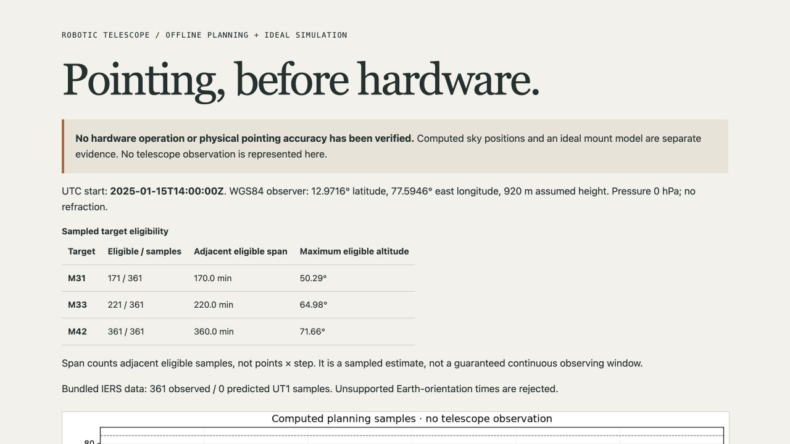

# Verification — 27 October 2026

Local runtime: macOS, Python 3.12.14, Astropy 8.0.2, PyERFA 2.0.1.5, NumPy 2.3.5, Matplotlib 3.11.2, and IERS data `0.2026.10.19.0.52.1`. Exact dependencies are in `requirements-benchmark.txt`. No telescope, motor, encoder, camera, or physical observing session was used.

## Behavior and reference checks

- **16 Python tests passed**, with **96.81% combined line/branch coverage**. They cover units/schema/time/count bounds, unsafe file types, duplicate/unsafe target IDs, published M33 reference altitude, inverse frame consistency, observed/predicted IERS status, unsupported time rejection, inclusive altitude/Sun boundaries, NaN exclusion, point/interval accounting, azimuth wrap, cable/rate/altitude limits, no overshoot, invalid transitions, fault hold, rehome requirements, full exports/CLI, no overwrite, and input-byte provenance binding.
- The M33 example uses Bear Mountain at 2012-07-13 03:00 UTC and agrees with the published Astropy altitude of approximately 0.13°. The inverse test checks frame/unit consistency to less than 0.001 arcsecond; it is not a physical accuracy measurement.
- A supported 2027 case returns predicted UT1 and polar-motion labels. The 2099 case fails for unsupported Earth-orientation coverage and retains **one ERFA dubious-year warning**. The warning is not suppressed; the valid historical demo produces no such warning.
- The non-symlink/FIFO fixture skips on Windows, where symlink creation needs developer privileges. Other schema, frame, fault, and file checks still run there.
- Ruff lint/format, Python compilation, and Git whitespace checks pass.

## Frozen data and calculations

The recorded source SHA256 is:

`55d060faa137be8e5535534c953bb4b3ce5685165e0117a6629cd5bb768865f6`

The IERS-A file SHA256 is:

`0baf00f67a39ab362a3e4f07d2a1f084842178523f56bcf5a861e7ac084d411a`

Finite rows for both UT1 and polar motion span MJD UTC 41684–61682, or 1973-01-02 to 2027-10-04. Exact per-sample statuses are checked in addition to those bounds. All 361 default samples are observed IERS-B, with no predicted values. The report retains the active ERFA leap-second table and dependency versions.

The fixed 2025 example has M31 171/361 eligible samples spanning 170 adjacent minutes, M33 221/361 spanning 220 minutes, and M42 361/361 spanning 360 minutes. The ideal mount has 443 records across 87.6 simulated seconds, rate maxima 3.0000000000000036°/s and 2°/s (floating-point tolerance), 11.2° unwrapped azimuth travel, a frozen position during the injected fault, and final state unhomed. No home declaration is counted as a physical timed move.

`tools/verify_recorded.py` recomputes all target/Sun coordinates, exact masks, rejection counts, windows, and the entire mount trace. It checks source/input/IERS provenance, with explicit 1e−8-degree numeric tolerances for cross-platform coordinate comparisons and exact counts/states. JSON serialization of leap-second tuples is normalized before comparing metadata; every value remains checked. Actual plots are generated from these saved calculations, not from image generation.

## Distribution integration

The wheel and source distribution build successfully. `tools/check_wheel.py` installs the wheel with no index/dependency resolution into a new temporary target, starts outside the application source tree, and asserts the imported package is from that target. With external connection creation blocked, it runs the bundled default request, a custom-plan command, the ideal simulation command, actual figures/reports, and CLI version. All passed. External scientific dependencies remain dependencies; no old source-tree application code supplies the installed run.

The bundled demo request is present in the wheel. Native dependency wheels, environments, caches, old tutorial assets, and private files are excluded. CI repeats the behavior, recorded-output, and installed-wheel checks on Python 3.12/3.13 across Linux, macOS, and Windows. Use the actual pull-request checks for CI status; these local results do not imply CI or physical acceptance.

## Visual review

The actual altitude and mount-state figures were inspected. The browser report displayed the exact sample/span counts, fixed UTC/location assumptions, observed-data status, rate/fault results, and hardware limits. Expanding the frame/constraint section revealed the source digest and solar/slew limitation. Local figure and JSON links loaded. A specific mobile viewport has not been independently tested in this record.

The screenshot is software output. The README's approved line-art cover is generated concept art. Neither is a telescope build or observing-session photograph.

## History and physical work

Original main `d6d844be448efeaaa16a7250e99eae285fe36f64` was verified on the remote archive before replacement. The approved rename retained ID `R_kgDOIIXOlA` and 17 stars. No old tutorial code/images were reused; no old license file was present. The portfolio source remains unchanged.

Physical assembly, electronics/limits, homing, optical alignment, measured pointing residuals, tracking drift, weather/terrain acceptance, and independent solar protection remain pending. No physical precision, successful observation, certified safety, or operational readiness is established.
